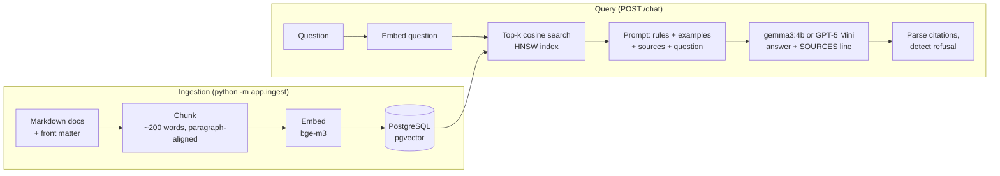

# Optik Assistant

A bilingual (English / Bahasa Indonesia) customer-service chatbot for an eyewear store, built with **retrieval-augmented generation (RAG)**. It answers questions about lenses, frames, contact lenses, eye care, and store policies **using only a curated knowledge base**, cites the documents it used, and says "I don't know" when the answer isn't there.

**Stack:** Python · OpenAI SDK · local LLMs via **Ollama** (`gemma3:4b`, `bge-m3` embeddings; free, runs on a 4 GB GPU) or the OpenAI API (GPT-5 Mini) · PostgreSQL + pgvector · FastAPI · plain HTML/JS

> The store policies in `knowledge_base/` are **fictional sample data** written for this demo. They are not the policies of Optik Melawai or any other real store. Nothing here is medical advice.

## How it works



1. **Ingestion:** each document is split into chunks of about 200 words along paragraph boundaries, with about 40 words of overlap. Each chunk is embedded together with its document title and stored in Postgres with pgvector.
2. **Retrieval:** the question is embedded and the `k` most similar chunks are found by cosine distance (`<=>`).
3. **Generation:** the question's language (Indonesian or English) is detected in code. The chunks go into the prompt as `<source>` blocks, together with the reply language and two few-shot examples. The model must answer only from the sources, use a fixed refusal sentence when they don't contain the answer, and end with a `SOURCES: id-one, id-two` line.
4. **Post-processing:** the `SOURCES` line (and any inline `[doc-id]` markers) is parsed, and cited ids are checked against the retrieved chunks, so the model can't cite a document it never saw. The refusal sentence marks the answer as out of scope. If the reply comes back in the wrong language, the model is asked once to rewrite it. The UI shows the cited sources under each answer.

## Evaluation

`eval/questions.jsonl` has 30 questions: 25 answerable from the knowledge base (including cross-lingual ones, such as an Indonesian question whose answer is in an English document) and 5 that are out of scope (prices, BPJS payments, LASIK, opening hours, an off-topic question).

For each question the runner records:

- **Answer correctness:** an LLM judge compares the answer with a reference answer and grades it correct, partial, or incorrect. The judge defaults to the chat model. Small local models are lenient or inconsistent graders, so use a larger judge when you can (`--judge-model qwen2.5:7b`), and spot-check the verdicts in the report.
- **Refusals:** whether out-of-scope questions were correctly refused, and whether in-scope questions were wrongly refused.
- **Retrieval hit rate:** whether an expected source document was among the retrieved chunks. This separates retrieval failures from generation failures.
- **Latency and token cost.**

```bash
python -m eval.run_eval --label baseline
```

Each run writes a JSON file and a Markdown report to `eval/results/` and adds a row to `eval/results/runs.md`.

### Results

All runs use `gemma3:4b` via Ollama, `bge-m3` embeddings, 200-word chunks with 40-word overlap, and top_k=5. They cost $0 and take about 4 minutes on a laptop RTX 3050 (4 GB).

| Run | Change | Correct | Partial | Wrongly refused | Out-of-scope refused | Retrieval hit | p50 latency |
|---|---|---|---|---|---|---|---|
| baseline | plain-text answers + few-shot examples | 16/25 | 8 | 1 | 5/5 | 100% | 4.5 s |
| v2 | robust `SOURCES` parsing, refusal override, language retry, stricter judge prompt | 21/25 | 3 | 0 | 4/5 | 100% | 4.7 s |
| v3 | a refusal followed by only a short remark stays a refusal | 21/25 | 3 | 0 | 5/5 | 100% | 4.8 s |

**What I learned:**

- **Retrieval was never the bottleneck.** The multilingual `bge-m3` embeddings found an expected document for all 25 in-scope questions, including every cross-lingual one. All remaining errors are in generation or grading.
- **Small models need a different output contract.** A first version asked for JSON (`{in_scope, answer, cited_doc_ids}`). With `gemma3:4b` this leaked field names into the answer text, mixed languages, and set `in_scope=true` on replies that said "I don't know". Moving decisions into code fixed this: detecting the language, a fixed refusal sentence, and a trailing `SOURCES:` line.
- **Few-shot examples beat rules.** When the refusal sentence was in the user message, the model opened every reply with it. Two worked examples (one answer, one refusal) fixed that.
- **The judge needs to be stronger than the model it grades.** In v3, a manual check of the 4 non-correct answers found 3 judge errors (answers penalised for extra detail, or misread), and only 1 genuinely incomplete answer (q10). A larger judge model (`--judge-model qwen2.5:7b`, or GPT-5 Mini) would give more trustworthy numbers.

## Setup

Requires Python 3.11+ and Docker. Ollama for the free local setup, or an OpenAI API key.

```bash
python -m venv .venv
.venv\Scripts\activate          # Windows  (macOS/Linux: source .venv/bin/activate)
pip install -r requirements.txt
cp .env.example .env            # defaults work as-is with Docker + Ollama
```

### Models

**Ollama (default, free):** install [Ollama](https://ollama.com/download), then pull the two models:

```bash
ollama pull gemma3:4b     # chat model, ~3.3 GB
ollama pull bge-m3        # multilingual embedding model, ~1.2 GB
```

`gemma3:4b` fits in 4 GB of VRAM. With more memory, `CHAT_MODEL=qwen2.5:7b` in `.env` usually answers better. `bge-m3` is multilingual, so an Indonesian question can retrieve an English document and vice versa.

**OpenAI:** set `LLM_PROVIDER=openai` and `OPENAI_API_KEY` in `.env`, then run `python -m app.ingest --reset` (the embedding dimension changes from 1024 to 1536).

### PostgreSQL + pgvector (pick one)

- **Docker (simplest locally):** install Docker Desktop, then run `docker compose up -d`. The default `DATABASE_URL` in `.env.example` already matches. The container is published on port **5433**, so it doesn't clash with a locally installed PostgreSQL on 5432.
- **Hosted, no install:** create a free Postgres database on [Neon](https://neon.tech) or [Supabase](https://supabase.com), both of which support pgvector, and paste its connection string into `DATABASE_URL`.
- **Native install:** install PostgreSQL, then build and install [pgvector](https://github.com/pgvector/pgvector#installation). On Windows this needs Visual Studio's C++ build tools.

The ingestion script creates the `vector` extension and the tables itself.

### Run

```bash
python -m app.ingest               # chunk + embed + store (re-runs only re-embed changed docs)
uvicorn app.main:app --reload      # then open http://localhost:8000
```

Useful endpoints: `GET /health` (document and chunk counts), `http://localhost:8000/docs` (interactive API docs).

```bash
curl -X POST localhost:8000/chat -H "Content-Type: application/json" \
     -d '{"question": "Apa arti AXIS di resep kacamata?"}'
```

### Tests

```bash
pytest
```

The unit tests cover chunking, document parsing, knowledge-base consistency (for example, every eval question points at real document ids), and citation handling. They need no database or API key.

## Tuning experiments

| Knob | How to change it |
|---|---|
| Chunk size / overlap | `python -m app.ingest --chunk-size 300 --overlap 50`, then re-run the eval |
| Retrieved chunks | `python -m eval.run_eval --label topk-3 --top-k 3` |
| Prompt | edit `SYSTEM_PROMPT` in `app/rag.py` |
| Model | `python -m eval.run_eval --label qwen7b --model qwen2.5:7b` (after `ollama pull qwen2.5:7b`) |
| Provider | `LLM_PROVIDER=openai` in `.env`, then `python -m app.ingest --reset` |
| Reasoning effort (OpenAI GPT-5) | `REASONING_EFFORT=minimal` / `medium` in `.env` |
| Similarity cut-off | `MIN_SIMILARITY=0.3` in `.env` drops weak matches before prompting |

## Design decisions

- **pgvector instead of a dedicated vector database.** The vectors live next to the document metadata in ordinary Postgres, so there is one system to run, joins and transactions work as usual, and an HNSW index keeps search fast as the collection grows.
- **Paragraph-aligned chunking with title prefix.** Chunks are packed from whole paragraphs, lists, and tables, so they rarely cut a sentence in half. Headings stay attached to their content. Embedding `title + chunk` gives a chunk like "Most people adapt within 1 to 2 weeks" the context of which product it's about.
- **One code path for local and hosted models.** Ollama serves an OpenAI-compatible API, so the app uses the OpenAI SDK for both and only the base URL and model names change. This makes a like-for-like comparison between a free local model and GPT-5 Mini on the same test set straightforward.
- **Decide in code whatever code can decide reliably.** The reply language is detected from the question with a small word list, and refusals use a fixed sentence per language that code recognizes. The model is only trusted with what needs a language model: writing a grounded answer. This is what made a free 4B model usable, and it works the same with GPT-5 Mini.
- **Citation validation.** Only ids of documents that were actually retrieved are kept, which guards against invented citations.
- **Incremental ingestion.** A hash of each document's content and the chunking settings decides whether to re-embed it, so tuning chunk size re-embeds everything while editing one document re-embeds only that one.
- **Separating retrieval from generation in the eval.** The retrieval hit rate shows whether a wrong answer came from retrieval (the right document was never found) or from generation (it was found but misused), and these need different fixes.

## Project structure

```
app/
  config.py      settings from .env
  documents.py   load Markdown docs + front matter
  chunking.py    paragraph-aligned chunking with overlap
  llm.py         OpenAI-compatible client (Ollama or OpenAI), embeddings
  db.py          pgvector schema, connection pool
  ingest.py      load → chunk → embed → store
  retrieval.py   cosine similarity search
  rag.py         prompt, generation, citations
  main.py        FastAPI app (/chat, /health, static UI)
  static/        chat page
knowledge_base/  21 documents (13 English, 8 Indonesian)
eval/            test questions, eval runner, results
tests/           unit tests
```

## Possible next steps

- Stream answers token by token.
- Conversation memory, so follow-up questions ("and for kids?") work.
- Hybrid search (keyword + vector) for exact terms such as "UV400" or "1.67".
- A local (gemma3:4b, qwen2.5:7b) vs. GPT-5 Mini comparison on accuracy, latency, and cost.
